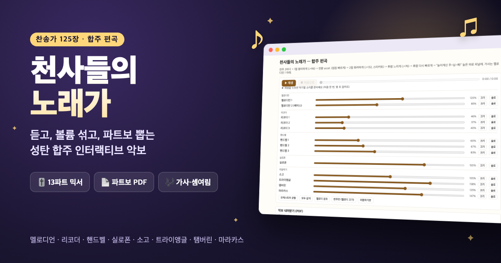
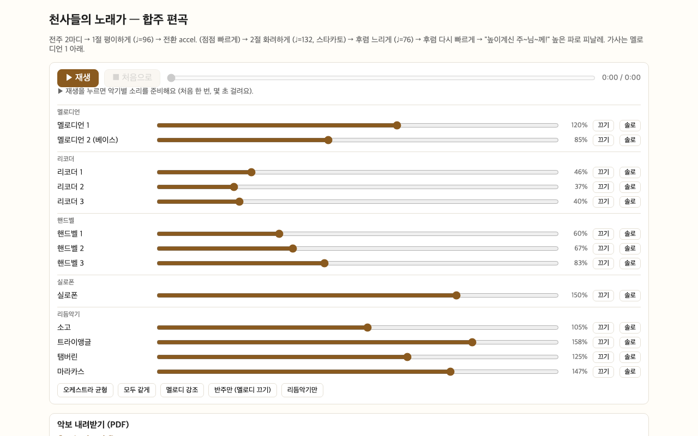

# 🎄 천사들의 노래가 — 13파트 합주 편곡

> 찬송가 125장을 **멜로디언·리코더·핸드벨·실로폰·리듬악기** 합주로 편곡하고, 브라우저에서 바로 **듣고 · 악기별 볼륨을 섞고 · 파트보를 내려받는** 인터랙티브 악보


## 🔗 라이브 데모

**https://angels-ensemble.vercel.app**

## ✨ 주요 기능

- 🎚️ **13파트 믹서** — 악기마다 볼륨 · 끄기 · 솔로. 재생 중에도 실시간 반영되고, "오케스트라 균형 / 멜로디 강조 / 반주만 / 리듬악기만" 프리셋 제공
- 🎼 **총보 + 가사** — 1·2절과 후렴 가사가 멜로디 아래에, 셈여림·빠르기·스타카토까지 표기
- 📄 **파트보 PDF 13종** — 각 악기 파트 위에 주멜로디와 가사를 함께 넣어, 노래 위치를 보면서 연주
- 🎬 **드라마틱한 구성** — 1절 평이하게 → 점점 빨라지는 전환 → 2절 화려하게(스타카토) → 후렴 느리게 → 다시 빠르게 → "높이계신 주~님~께!" 높은 파로 피날레
- 🔔 **학교 악기 맞춤** — 핸드벨·실로폰은 시♭ 없이 8음 다장조 세트로 연주 가능, 멜로디언 32건반 음역 안

## 🎻 편성

| 그룹 | 파트 |
|---|---|
| 멜로디언 | 1 (멜로디) · 2 (베이스) |
| 리코더 | 1 (멜로디/데스캔트) · 2 (알토) · 3 (화음/엇박) |
| 핸드벨 | 1 (도·레·미) · 2 (파·솔) · 3 (라·높은도) |
| 실로폰 | 1 |
| 리듬악기 | 소고 · 트라이앵글 · 탬버린 · 마라카스 |

## 🛠 기술 이야기

- 악보는 **ABC 표기**를 Python(`src/gen.py`)으로 생성 — 화성 진행표에서 핸드벨 보이싱·실로폰 아르페지오·베이스 리듬을 자동으로 뽑고, 마디 길이·가사 음절 수를 검사
- 렌더링·재생은 **abcjs**. 믹서는 abcjs로 악기를 **하나씩 따로 렌더링**한 오디오 버퍼를 Web Audio `GainNode`로 섞는 방식
- PDF는 headless Chrome으로 줄(시스템)별 SVG를 뽑아 페이지가 시스템 중간에서 잘리지 않게 조판

## 🚀 로컬 실행

```bash
cd src && ./build.sh   # HTML · 총보 PDF · 파트보 PDF 13종 생성
open index.html
```



---
선율: 프랑스 전통 캐럴 *Les Anges dans nos campagnes* (GLORIA) · 합주 편곡
